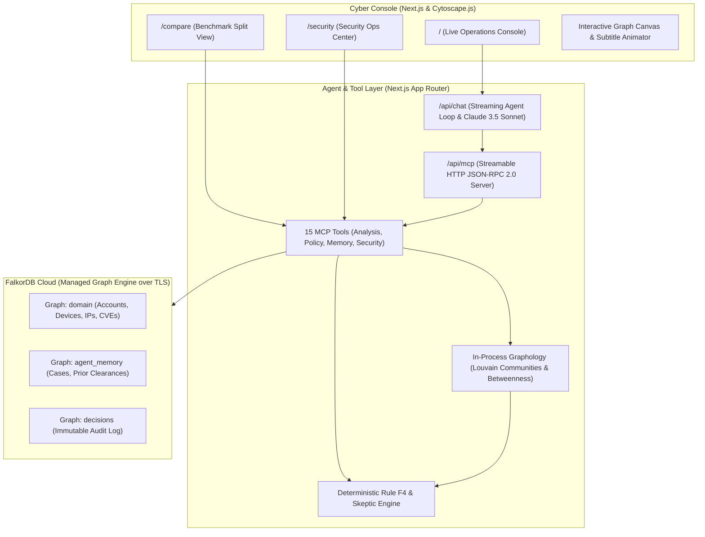

# SENGRA — Graph-Native Fraud Ring Investigation Agent

> Autonomous multi-hop fraud detection and cross-domain cybersecurity intelligence powered by FalkorDB Cloud, Model Context Protocol (MCP), Vercel AI SDK, Graphology, and Cytoscape.js.

[](https://github.com/Precise-Goals/sengra/actions)
[](scripts/verify_gates.py)
[](docs/eval-report.md)
[](LICENSE)

---

## 1. What is SENGRA?

SENGRA is a graph-native investigation agent that autonomously detects, traces, and intercepts sophisticated financial fraud syndicates in real time. Unlike traditional tabular fraud engines that rely on single-row heuristic rules—leading to high false positives on innocent families and high false negatives on layered mule networks—SENGRA leverages topological graph algorithms and cross-session memory to make explainable, policy-gated decisions.



---

## 2. Benchmark Scoreboard: SENGRA vs Legacy Flat-Table Baseline

Tested against a standardized benchmark dataset of 22 accounts representing planted fraud rings, benign clusters, and clean controls:

| Metric | SENGRA Graph Agent | Flat-Table Baseline | Advantage / Delta |
|---|---|---|---|
| **Precision** | **100.0%** | 54.5% | **+45.5%** |
| **Recall (Sensitivity)** | **100.0%** | 50.0% | **+50.0%** |
| **F1 Score** | **1.000** | 0.522 | **+0.478** |
| **False Positive Rate (FPR)** | **0.0%** | 50.0% | **-50.0%** |
| **Overall Accuracy** | **100.0%** | 50.0% | **+50.0%** |

* Run benchmark yourself: `pnpm eval`
* Read detailed failure mode analysis: [docs/eval-report.md](docs/eval-report.md)

---

## 3. Core Capabilities

### 🔍 1. Multi-Hop Fraud Ring Interception (Rule F4)
Intercepts structured mule syndicates (**Ring A**) operating across multiple layers. Even when a collector mule logs in using a clean device, SENGRA traces the 2-hop device link to known-bad hardware (`D-17`) and circular transaction structures, triggering an automated freeze.

### 🛡️ 2. Proactive Skeptic Challenge (Zero False Freezes)
When innocent households share residential Wi-Fi and addresses (**Ring B**), legacy engines falsely freeze them. SENGRA runs a proactive **Skeptic Challenge** before considering any restrictive action: verifying legitimate residential IP ranges, lack of circular transactions, and zero bad devices to clear the cluster.

### 🧠 3. Cross-Session Memory & Associative Recall
Decisions and clearances are written to the persistent `agent_memory` graph. On subsequent sessions, SENGRA immediately recalls past investigations in $< 5$ms, citing prior findings and avoiding redundant customer friction.

### ⚡ 4. Security Bonus Layer: CVE-to-Fraud Cross-Domain Bridge
Bridges software vulnerabilities to financial crime risks:
$$\text{CVE-2024-3094} \longrightarrow \text{xz-utils} \longrightarrow \text{Auth Gateway} \longrightarrow \text{Leaked Credentials} \longrightarrow \text{4 Compromised Accounts}$$
Evaluates finding priority dynamically, escalating vulnerabilities linked to live fraud to **P0 CRITICAL (1-Hour SLA)** with one-click automated remediation.

---

## 4. MCP Tool Catalog (15 Discoverable Tools)

All tools are served via Streamable HTTP JSON-RPC 2.0 at `/api/mcp`:

| Category | Tool | Description |
|---|---|---|
| **Fraud Core** | `recall_entity` | Retrieve 1-hop or 2-hop neighborhood for any graph entity |
| | `detect_communities` | Run community partitioning on suspect subgraphs |
| | `analyze_subgraph` | In-process Graphology Louvain communities & betweenness |
| | `shortest_path` | Find shortest paths between entities in FalkorDB |
| | `skeptic_challenge` | Proactively evaluate benign family cluster hypotheses |
| | `evaluate_freeze_policy` | Evaluate deterministic Rule F4 freeze criteria |
| | `freeze_account` | Execute simulated account lock |
| | `open_case` | Create structured investigation case in memory |
| | `notify` | Dispatch simulated security alerts |
| | `record_decision` | Append immutable decision & evidence path to audit graph |
| | `run_cypher_readonly` | Execute read-only Cypher query with strict safety guards |
| **Security Bonus** | `cve_to_fraud_links` | Cross-domain bridge from CVE to compromised accounts |
| | `blast_radius` | Compute downstream dependent microservices & datastores |
| | `evaluate_finding_priority`| Calculate composite vulnerability priority score |
| | `who_knows_system` | Identify owning team and on-call engineers for incident paging |

---

## 5. Quickstart Guide

### Prerequisites
* **Node.js**: `v20+`
* **pnpm**: `v9.15+`
* **Bun**: `v1.1+` (for fast test execution)
* **Python**: `v3.11+` (for harness verification)

### Installation
```bash
git clone https://github.com/Precise-Goals/sengra.git
cd sengra
pnpm install
```

### Run Interactive Terminal Demo
Experience all 5 capabilities in an automated end-to-end walkthrough:
```bash
pnpm demo
# or
node scripts/demo.js
```

### Run Quantitative Evaluation Benchmark
```bash
pnpm eval
```

### Start Web Application
```bash
pnpm turbo run dev --filter=@sengra/web
```
Open your browser:
* **Live Investigation Console**: `http://localhost:3000`
* **Side-by-Side Benchmark**: `http://localhost:3000/compare`
* **Security Operations Center**: `http://localhost:3000/security`

---

## 6. Verification & Quality Gates (G0 - G4)

SENGRA enforces deterministic quality gates per [docs/harness.md](docs/harness.md):

```bash
# Run all gates in a single automated command:
python scripts/verify_gates.py
```

| Gate | Purpose | Command | Result |
|---|---|---|---|
| **G0** | Harness Integrity & Linters | `python scripts/check_harness.py && pytest tests/harness` | **21 / 21 PASS** |
| **G1** | Compilation & Next.js Build | `pnpm turbo run build` | **CLEAN BUILD** |
| **G2** | Unit & Integration Testing | `bun test tests/unit && bun test tests/integration` | **71 / 71 PASS** |
| **G3** | Evaluation Benchmark Margin | `pnpm eval` | **> 25% MARGIN** |
| **G4** | Security & Parameterization Audit | `assertReadOnlyCypher & $ bindings check` | **ZERO INJECTIONS** |

---

## 7. Architecture & References

* **System Architecture**: [docs/architecture.md](docs/architecture.md)
* **Evaluation Benchmark Report**: [docs/eval-report.md](docs/eval-report.md)
* **Harness & Roles Specification**: [docs/harness.md](docs/harness.md)
* **Operating Prompt & Boot Sequence**: [docs/prompt.md](docs/prompt.md)
* **Lessons & Anti-Patterns Log**: [docs/memory/lessons.md](docs/memory/lessons.md)

---

## License

Distributed under the MIT License. See `LICENSE` for details.
