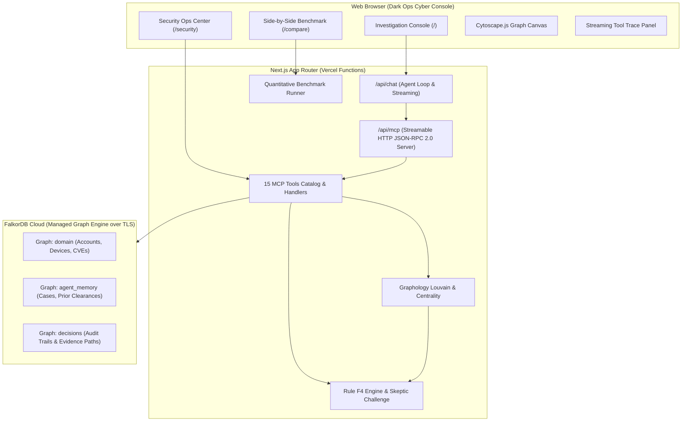
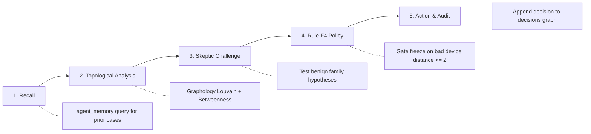

# SENGRA — System Architecture & Design Specification

> Graph-Native Fraud Ring Investigation Agent with Cross-Domain Security Correlation

---

## 1. System Overview

SENGRA is an autonomous fraud investigation system combining high-performance graph database queries (**FalkorDB Cloud**), open tool interoperability (**Model Context Protocol - MCP**), topological network analytics (**Graphology**), and an LLM orchestration loop (**Vercel AI SDK + Claude 3.5 Sonnet**) wrapped in a dark ops cyber console built with **Next.js** and **Cytoscape.js**.



---

## 2. Multi-Graph Strategy (3 Graphs in 1 Cloud Instance)

To ensure operational isolation and audit compliance, SENGRA divides data into three distinct graph spaces hosted on a single FalkorDB instance using environment-prefixed naming (e.g. `dev_domain`, `prod_domain`):

| Graph Name | Schema Focus | Access Pattern | Retention |
|---|---|---|---|
| `domain` | Financial entities (Account, Device, IP, Card, Merchant) and Security assets (Service, Package, CVE, Credential) | Read-mostly traversals with strict `assertReadOnlyCypher` guard | Planted synthetic dataset (re-seedable) |
| `agent_memory` | Investigation cases, entity clearances, flags, and learned patterns | Read-write associative recall | Persistent cross-session store |
| `decisions` | Immutable audit decisions, Cypher logs, evidence node paths, and operator actions | Append-only audit record | Permanent compliance log |

---

## 3. The Fraud Investigation Pipeline

When an anomalous alert is triggered, SENGRA executes a 5-stage deterministic investigation:



### Rule F4 Specification
An automated account freeze is **ONLY** approved if all three conditions hold:
1. The target account resides in a connected component with $\ge 3$ flagged accounts.
2. The target account is within $\le 2$ hops of a confirmed bad device (`known_bad: true`).
3. The account has not been cleared by a prior Skeptic challenge in `agent_memory`.

If evidence is partial (e.g. ring exists but distance $> 2$ hops), the account is routed to **`HOLD`** for human review. If the Skeptic identifies a legitimate explanation (shared family Wi-Fi/address with normal payment velocity), the account is marked **`NO_ACTION`** (cleared).

---

## 4. Security Bonus Layer: Cross-Domain Correlation

SENGRA bridges infrastructure vulnerabilities directly to financial crime risks:

```
(CVE: { id: "CVE-2024-3094", cvss: 10.0 })
       ^
       | [:AFFECTED_BY]
(Package: { name: "xz-utils@5.6.0" })
       ^
       | [:USES_PACKAGE]
(Service: { id: "SVC-AUTH-PORTAL", tier: "TIER_0" })
       ^
       | [:GRANTS_ACCESS_TO]
(Credential: { id: "CRED-LEAKED-HASH", compromised: true })
       |
       | [:USED_BY]
       v
(Account: { id: "A-TAKEOVER-1" }) ---> [:PAID_TO] ---> (Mule Ring)
```

- **Dynamic Priority Scoring**:
  $$\text{Score} = (\text{CVSS} \times 5) + (\text{Internet Exposed} \ ?\ 20 : 0) + (\text{Customer PII} \ ?\ 15 : 0) + (\text{Fraud Linked} \ ?\ 50 : 0)$$
  Any CVE enabling active fraud immediately escalates to **`P0 CRITICAL`** (1-hour SLA) with automated credential revocation and PagerDuty routing.

---

## 5. Security & Read-Only Guardrails

All Cypher queries executed across SENGRA are strictly protected:
- **Zero Unparameterized Queries**: All parameters bound via `$param` to eliminate Cypher injection.
- **AST Mutation Inspection**: `assertReadOnlyCypher` rejects keywords `CREATE`, `DELETE`, `SET`, `REMOVE`, `MERGE`, `DROP`, `ALTER`, `GRANT`, `REVOKE`.
- **Bounded Row Limits**: Enforced row limits ($\le 1,000$) prevent memory exhaustion.
