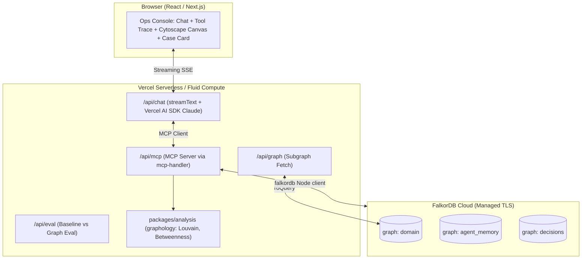
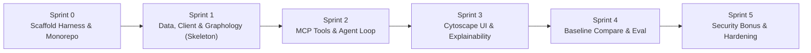

# harness.md — SENGRA: Graph-Native Fraud Agent

> Single source of truth for the SENGRA harness.
> Derived from [raw.md](file:///D:/Workspace/Projects/sengra/docs/raw.md) (Problem Statement & Specification).

---

## 1. Problem Statement

Fraud analysts and automated risk agents typically examine transactions and accounts in isolation, blind to multi-hop network connections where organized fraud rings operate. Conventional approaches suffer from:
1. **Disconnected signals**: Individual transactions appear benign, while shared devices, IPs, physical addresses, and circular payment loops reveal fraud rings.
2. **Amnesia**: Lack of persistent cross-session memory forces repeated re-investigation of previously cleared or flagged entities.
3. **Black-box decisions**: Opaque risk scores lack verifiable evidence chains.
4. **False-positive disruption**: Benign clusters (e.g., families sharing an IP and address) are mistakenly frozen.
5. **Security-fraud silos**: Credential leaks from unpatched services are not bridged to live account takeover fraud.

**SENGRA** solves this by combining **FalkorDB Cloud**, **Model Context Protocol (MCP)** tools, the **Vercel AI SDK (Claude)**, in-process **graphology** graph analysis, and an interactive **Cytoscape.js** UI to follow multi-hop graph relationships, execute graph algorithms, enforce deterministic policy gates, verify benign explanations (Skeptic check), remember past investigations across sessions, and animate explainable evidence paths.

Detailed problem statement and specification: [raw.md](file:///D:/Workspace/Projects/sengra/docs/raw.md).

---

## 2. Goals & Non-Goals

### Goals
- **P0 (Fraud Core - Must Ship)**:
  - Multi-hop entity expansion around accounts, devices, IPs, cards, addresses, and transactions.
  - Dual-path graph algorithms: in-database FalkorDB algorithms (`algo.WCC`, `algo.pageRank`, shortest path) and in-process `graphology` analysis (Louvain communities, betweenness centrality, WCC cross-check).
  - MCP tool discovery and execution via `@modelcontextprotocol/sdk` and Next.js `mcp-handler`.
  - Graph-gated actions: strict policy evaluating components, known-bad devices, and clearances to return `FREEZE`, `HOLD`, or `NO_ACTION`.
  - Cross-session memory across separate graph partitions (`agent_memory` and `decisions`).
  - Explainability: evidence paths saved as graph edges and animated in the UI.
  - Skeptic check: proactive clearance testing for benign clusters (e.g. family sharing IP/address).
- **P1 (Should Ship)**:
  - Baseline comparison: flat-table agent (no graph tools) vs. graph-native agent with metrics (precision, recall, tool call count, execution time).
  - Polished dark ops console UI (Cytoscape.js canvas, streaming tool trace, case report card).
- **P2 (Bonus - After P0/P1)**:
  - Security triage layer connecting CVEs, packages, vulnerable services, and credentials to active fraud accounts.
- **P3 (Stretch Goal)**:
  - Multi-agent orchestration split (Investigator, Skeptic, Actioner).

### Non-Goals
- Self-hosted FalkorDB or Docker infrastructure (managed FalkorDB Cloud only).
- Python backend or NetworkX dependency (100% plain ES modules JavaScript; `graphology` is the graph analysis engine).
- TypeScript for application code (plain ESM with JSDoc typing + runtime Zod schema parsing).
- Production banking integrations (seeded deterministic synthetic data via `@faker-js/faker`).
- Real destructive actions (all freezes/notifications are simulated and audit-logged to the `decisions` graph).

---

## 3. Users & Use Cases

| Persona | Primary Goal | Example Workflow |
|---|---|---|
| **Fraud Analyst** | Detect rings & investigate alerts | Input flagged transaction → agent expands multi-hop neighbors, identifies ring via WCC, ranks ringleader via PageRank, and visualizes highlighted subgraph |
| **Risk Manager** | Verify compliance & audit decisions | Inspect frozen account case card → review plain-English narrative, verified Cypher query, and highlighted evidence path |
| **Security Engineer** (Bonus) | Identify breach-to-fraud exposure | Query vulnerable Internet-exposed service → trace CVE to leaked credential to compromised accounts enabling fraud |
| **SecOps Lead** (Bonus) | Prioritize vulnerability remediation | Prioritize CVEs that actively bridge to downstream financial fraud over isolated high-CVSS decoys |

---

## 4. Requirements

| ID | Statement | Priority | Source |
|---|---|---|---|
| `REQ-001` | Multi-hop traversal tool expanding entities across accounts, devices, IPs, cards, and addresses | Must | raw.md §4 F1 |
| `REQ-002` | In-database FalkorDB graph algorithms (WCC, PageRank, shortestPath) exposed via MCP | Must | raw.md §4 F2, §5.6 |
| `REQ-003` | In-process `graphology` analysis (Louvain communities, betweenness, WCC cross-check) | Must | raw.md §4 F2, §5.6 |
| `REQ-004` | Tool selection and serving through standard MCP server (`/api/mcp`) | Must | raw.md §4 F3, §9.1 |
| `REQ-005` | Deterministic graph-gated policy engine (`FREEZE`, `HOLD`, `NO_ACTION`) | Must | raw.md §4 F4, §5.4 |
| `REQ-006` | Cross-session memory recalling past cases, clearances, and learned patterns (`agent_memory` graph) | Must | raw.md §4 F5, §8.3, §12 |
| `REQ-007` | Explainable outputs with evidence paths, Cypher queries, and narrative reasoning (`decisions` graph) | Must | raw.md §4 F6, §8.4, §14 |
| `REQ-008` | Skeptic challenge rule engine verifying benign explanations before action | Must | raw.md §4 F7, §11 |
| `REQ-009` | Deterministic synthetic dataset generator with planted scenarios (Ring A, Ring B, Noise, Ring C) | Must | raw.md §11 |
| `REQ-010` | React/Next.js investigation UI with animated Cytoscape.js graph canvas | Should | raw.md §4 F9, §13.2 |
| `REQ-011` | Streaming reasoning trace panel and case report card | Should | raw.md §4 F9, §13.3, §13.4 |
| `REQ-012` | Baseline evaluation runner comparing flat-table agent against graph-native agent | Should | raw.md §4 F8, §15 |
| `REQ-013` | Security triage bonus layer linking CVEs to credentials and compromised accounts | Could | raw.md §4 F10, §8.2, §9.2 |
| `REQ-014` | Multi-agent split (Investigator, Skeptic, Actioner) sharing graph state | Won't | raw.md §4 F11 |

---

## 5. Acceptance Criteria

- **`AC-001-a` (REQ-001)**: Given an account ID and max hops, when `get_neighbors` is invoked, then a connected subgraph within those hops is returned.
- **`AC-001-b` (REQ-001)**: Given a transaction or account ID, when `find_linked_accounts` is called, then all accounts linked via shared devices, cards, or addresses are returned.
- **`AC-002-a` (REQ-002)**: Given the domain graph containing Ring A, when `find_rings` is called, then FalkorDB `algo.WCC` returns the component containing all 8 accounts with flagged count ≥ 3.
- **`AC-002-b` (REQ-002)**: Given a detected ring component, when `rank_central_nodes` runs, then FalkorDB `algo.pageRank` ranks the collector mule as the top score.
- **`AC-002-c` (REQ-002)**: Given two connected accounts in a component, when `shortest_path` is called, then an exact edge-by-edge path between them is returned.
- **`AC-003-a` (REQ-003)**: Given a suspect subgraph extracted from FalkorDB, when `analyze_subgraph` is executed by `packages/analysis`, then `graphology` returns Louvain community IDs, betweenness centrality scores, and connected component counts.
- **`AC-003-b` (REQ-003)**: Given a discrepancy between FalkorDB WCC and graphology components, when evaluated by policy, then confidence is downgraded and action routes to `HOLD`.
- **`AC-004-a` (REQ-004)**: Given the MCP endpoint at `/api/mcp`, when queried by an MCP client, then all fraud tools with valid Zod input schemas are discovered and executable.
- **`AC-004-b` (REQ-004)**: Given an HTTP request to `/api/mcp` without a valid `MCP_SHARED_SECRET`, when processed, then the server responds with 401 Unauthorized.
- **`AC-005-a` (REQ-005)**: Given an account in a component with ≥ 3 flagged accounts, within 2 hops of a known-bad device, and without prior clearance, when `evaluate_freeze_policy` runs, then the verdict is `FREEZE`.
- **`AC-005-b` (REQ-005)**: Given an account with partial ring evidence, when `evaluate_freeze_policy` runs, then the verdict is `HOLD` for human review.
- **`AC-006-a` (REQ-006)**: Given a concluded investigation, when `record_decision` is called, then decision metadata, evidence path edges, and outcome are persisted to `agent_memory` and `decisions`.
- **`AC-006-b` (REQ-006)**: Given an entity previously cleared in Case C-001, when a subsequent alert involves that entity, then `recall_entity` retrieves the clearance record and avoids redundant traversal.
- **`AC-007-a` (REQ-007)**: Given an agent decision, when returned to the UI, then it includes structured JSON with `decision`, `target`, `confidence`, `policy`, `explanation`, `evidencePath`, and `cypher`.
- **`AC-008-a` (REQ-008)**: Given Ring B (family cluster sharing address and Wi-Fi IP without known-bad devices or circular payments), when `skeptic_challenge` evaluates it, then a benign explanation is returned and policy outputs `NO_ACTION`.
- **`AC-009-a` (REQ-009)**: When `pnpm seed` is executed, then 1,500–3,000 nodes are deterministically generated into FalkorDB `domain` graph, producing Ring A (mule ring), Ring B (family cluster), and noise, matching `ground_truth.json`.
- **`AC-010-a` (REQ-010)**: Given the investigation UI, when an alert is selected, then Cytoscape.js renders the subgraph and highlights the evidence path edges in animated sequence.
- **`AC-011-a` (REQ-011)**: When `/api/chat` streams execution steps, then the live reasoning panel displays tool names, arguments, execution durations, and case report card metrics in real time.
- **`AC-012-a` (REQ-012)**: When `pnpm eval` is executed, then precision, recall, tool call count, and decision latency are output for both the baseline flat agent and graph agent against `ground_truth.json`.
- **`AC-013-a` (REQ-013)**: Given the security data layer, when `cve_to_fraud_links` is invoked, then it traces an unpatched Internet-exposed service through leaked credentials to active compromised accounts.

---

## 6. Architecture & Tech Stack

### System Architecture


### Stack Selections
- **Monorepo**: Turborepo + pnpm workspaces.
- **Language**: JavaScript (ES modules, `"type": "module"`), JSDoc editor types, runtime Zod validation.
- **Frontend**: Next.js 16 (App Router), React 19, Tailwind CSS v4, shadcn/ui, Framer Motion.
- **Graph Visualization**: Cytoscape.js (`react-cytoscapejs`) with concentric and force layouts.
- **Agent Framework**: Vercel AI SDK (`ai`, `@ai-sdk/anthropic`) with Anthropic Claude 3.5 Sonnet.
- **Tool Protocol**: Model Context Protocol (`@modelcontextprotocol/sdk` + `@modelcontextprotocol/server-*`).
- **Graph Database**: FalkorDB Cloud (managed instance over TLS via `falkordb` Node.js client).
- **In-process Graph Analysis**: `graphology`, `graphology-communities-louvain`, `graphology-metrics`, `graphology-components`.
- **Testing**: Vitest (pure unit/integration tests) + pytest (harness verification).
- **Hosting**: Vercel (web app & route handlers) + FalkorDB Cloud (database).

---

## 7. Project Structure

```
sengra/
  package.json                        # Root workspace scripts delegating to turbo
  pnpm-workspace.yaml                 # apps/*, packages/*
  turbo.json                          # Pipeline: build, dev, lint, test, seed, eval
  AGENTS.md                           # Orchestration index (≤ 150 lines)
  CLAUDE.md                           # IDE pointer to AGENTS.md
  .mcp.json                           # Local MCP servers configuration
  docs/
    prompt.md                         # Operating manual
    raw.md                            # Problem statement & specification
    harness.md                        # This start document
    memory/                           # interview.md, assumptions.md, lessons.md, glossary.md
    adr/                              # Architecture Decision Records
  harness/
    profile.yaml                      # Project profile derived from raw.md
    agents/                           # Skinny agent pointers (≤ 40 lines each)
    roles/                            # 12-section fat role definitions
    workflows/                        # pipeline.md, sprint-template.md, parallel-lanes.md
    standards/                        # coding.md, testing.md, git.md, handoff-contract.md, definition-of-done.md
    tools/                            # registry.yaml, sandbox.md
    state/                            # state.json, state.schema.json, budgets.json, locks/
    artifacts/<TASK-ID>/              # Stage artifacts 01-spec through 08-docs + handoffs
    tasks/<TASK-ID>.md                # Sprint task definitions
    backlog.md                        # Prioritized backlog
    logs/                             # session.log.md, events.jsonl, decisions.log.md, failures.log.md
  scripts/
    check_harness.py                  # Deterministic harness linter
    guard_paths.py                    # Role write allow-list guard
    breaker.py                        # Circuit breaker enforcement
  tests/harness/
    test_harness.py                   # Pytest suite validating harness integrity
  apps/
    web/                              # Next.js App Router application
      src/app/                        # page.jsx, compare/page.jsx, memory/page.jsx, api/
      src/components/                 # Chat, canvas, trace, case card components
      src/lib/                        # Client utilities and helpers
  packages/
    graph/                            # FalkorDB client singleton, connection caching, graph selection
    schema/                           # Zod schemas & JSDoc types for entities, edges, tool I/O
    tools/                            # MCP tool implementations (traversal, algo, policy, memory)
    policy/                           # Pure deterministic freeze and skeptic rules
    memory/                           # Agent memory recall and record operations
    analysis/                         # Graphology subgraph analytics (Louvain, betweenness)
    data/                             # Seeded synthetic generator, ground truth, seed CLI
    agent/                            # System prompts, tool orchestration, baseline flat agent
    ui/                               # Shared Tailwind / shadcn components
    eval/                             # Evaluation runner comparing graph agent vs baseline
    config/                           # Shared ESLint, Prettier, and JSConfig settings
```

---

## 8. Commands

Canonical commands allowed during development:

| purpose | command |
|---|---|
| install | `pnpm install` |
| lint | `pnpm turbo run lint` |
| format | `pnpm prettier --check "**/*.{js,jsx,json,md,yaml}"` |
| typecheck | `pnpm turbo run check-types` |
| unit test | `pnpm turbo run test` |
| integration test | `pnpm turbo run test:integration` |
| build | `pnpm turbo run build` |
| harness self-test | `python scripts/check_harness.py && pytest tests/harness` |
| seed data | `pnpm seed` |
| seed reset | `pnpm seed:reset` |
| run eval | `pnpm eval` |

---

## 9. Coding & Testing Standards

- **Language Standard**: Plain ECMAScript Modules (ESM). Every `package.json` specifies `"type": "module"`.
- **Type Safety Without Transpilation**: JSDoc `@typedef`, `@param`, `@returns` annotations for editor hints; Zod `.parse()` for all external boundaries (API requests, MCP tool arguments, database query results).
- **Pure Functions for Business Logic**: Policies in `packages/policy` and graph algorithms in `packages/analysis` must remain pure functions tested without network or database dependencies.
- **Connection Caching**: FalkorDB client cached on `globalThis` to survive serverless warm restarts.
- **Test Pyramid**:
  - Unit tests (Vitest): Fast (<100ms), hermetic, 0 network, mocking database runners.
  - Integration tests (Vitest): Real queries against FalkorDB Cloud using test graph prefixes (`test_*`).
  - Harness self-tests (pytest): Hermetic checks verifying repo structure, schema, roles, and breaker rules.
- **Coverage Floor**: 80% line coverage required on new or modified lines in `packages/*`.
- **Forbidden Cheats**: Deleting/skipping tests (`test.skip`), adding blanket lint ignores (`/* eslint-disable */`), or empty catch blocks.

---

## 10. Tools, APIs & MCP Servers

### MCP Tool Inventory
- `recall_entity`: Query `agent_memory` for prior cases, clearances, and flags.
- `get_neighbors`: Multi-hop entity traversal from start node within hop limit.
- `find_linked_accounts`: Discover accounts sharing devices, cards, or addresses.
- `find_rings`: Execute FalkorDB `algo.WCC` to find connected components.
- `rank_central_nodes`: Execute FalkorDB `algo.pageRank` to identify collector mules.
- `detect_communities`: Execute FalkorDB label propagation on a component.
- `analyze_subgraph`: Extract subgraph into `graphology` to compute Louvain communities and betweenness.
- `shortest_path`: Compute Cypher shortest path between two accounts.
- `skeptic_challenge`: Evaluate benign explanations (family cluster, merchant hub).
- `evaluate_freeze_policy`: Evaluate evidence against deterministic policy rules.
- `freeze_account`: Execute simulated freeze action and log to audit graph.
- `open_case`: Create case entity in `agent_memory`.
- `notify`: Dispatch simulated risk alert.
- `record_decision`: Save decision, evidence path, and Cypher to `decisions` graph.
- `run_cypher_readonly`: Guarded read-only Cypher query fallback (`roQuery`).

### External APIs & Local MCP
- **FalkorDB Cloud**: Managed graph instance via TLS (`falkordb` client).
- **Anthropic API**: Claude 3.5 Sonnet via Vercel AI SDK.
- **Local MCP Servers (`.mcp.json`)**: filesystem, git, fetch, memory.

---

## 11. Autonomy & Approval Matrix

| Action | Allowed Roles | Approval Mode | Condition / Guard |
|---|---|---|---|
| Read graph & recall memory | All enabled roles | `auto` | Read-only operations |
| Run graph algorithms (WCC, PageRank) | Builder, QA, Test Author | `auto` | Per-command timeout ≤ 120s |
| Execute read-only Cypher (`roQuery`) | Builder, QA | `auto` | Row limit ≤ 1,000, no mutations |
| Execute simulated account freeze | Orchestrator, Builder | `auto` | Gated by policy verdict `FREEZE` |
| Reseed development database (`pnpm seed`) | Builder | `auto` | Target graph prefix must be `dev_` or `test_` |
| Destructive database drop (`DROP GRAPH`) | None | `forbidden` | Agents may never drop databases |
| Install new npm dependencies | Builder | `confirm` | Explicit human approval required |
| Deploy to production hosting | None | `forbidden` | Human manual action only |

---

## 12. Sprint Plan



### Sprint Breakdown
- **Sprint 0: Scaffold Harness & Monorepo**
  - *Goal*: Clean monorepo workspace, Turborepo setup, harness scripts, and passing G0 gate.
  - *Tasks*: `T-0000` (Monorepo & package layout), `T-0001` (Harness linters, guards & pytest suite).
  - *Exit Gate*: `python scripts/check_harness.py` passes; `pytest tests/harness` passes; `pnpm turbo run build` succeeds.
- **Sprint 1: Data, Graph Client & Core Algorithms (Walking Skeleton)**
  - *Goal*: FalkorDB client, seeded synthetic generator, pure policy engine, and graphology analysis.
  - *Tasks*: `T-0002` (FalkorDB connection & schema package), `T-0003` (Seeded data generator & ground truth), `T-0004` (Graphology analysis & pure policy).
  - *Exit Gate*: Ring A and Ring B seeded; Vitest unit tests pass for WCC, PageRank, Louvain, and freeze policy.
- **Sprint 2: MCP Tool Server & Agent Loop**
  - *Goal*: All P0 fraud tools registered on `/api/mcp`, agent loop via `/api/chat`, and memory persistence.
  - *Tasks*: `T-0005` (MCP tool implementations), `T-0006` (Agent loop with streaming & tool selection), `T-0007` (Cross-session memory persistence).
  - *Exit Gate*: End-to-end alert investigation freezes Ring A, clears Ring B, and second session cites first session.
- **Sprint 3: UI & Visual Explainability**
  - *Goal*: Dark ops console, animated Cytoscape.js canvas, streaming trace panel, case report card.
  - *Tasks*: `T-0008` (Next.js layout & Cytoscape canvas), `T-0009` (Live trace & case card), `T-0010` (Animated evidence path).
  - *Exit Gate*: One-click demo alert animates graph path in sync with agent explanation sentence.
- **Sprint 4: Baseline Comparison & Evaluation**
  - *Goal*: Flat-table baseline agent, `/compare` UI, metrics evaluation suite (`pnpm eval`).
  - *Tasks*: `T-0011` (Flat-table baseline agent), `T-0012` (Eval script & compare view).
  - *Exit Gate*: Side-by-side run proves graph agent precision/recall superior to baseline.
- **Sprint 5 (Bonus): Security Layer & Hardening**
  - *Goal*: CVE-to-fraud bridge query, blast radius tool, README, demo script.
  - *Tasks*: `T-0013` (Security schema & bridge query), `T-0014` (Hardening, documentation, demo recording).
  - *Exit Gate*: All §9 quality gates green; README includes screenshots and benchmark numbers.

---

## 13. Risks & Mitigations

| Risk | Impact | Mitigation |
|---|---|---|
| Solo developer scope creep | High | Strict P0–P3 hierarchy; security layer (P2) cut if fraud core is incomplete by Day 6 |
| FalkorDB cannot run on Vercel | Critical | Managed FalkorDB Cloud instance over TLS; cached client on `globalThis` |
| Cloud plan query latency | Medium | Subgraph filtering in DB before in-process analysis; function region co-located with DB |
| `graphology` vs `NetworkX` parity | Medium | Use only core algorithms (Louvain, betweenness, components); unit test on known graph fixtures |
| Serverless execution timeout | High | Set `maxDuration = 60` on `/api/chat`; stream partial tool steps immediately to UI |
| SDK / AI SDK version churn | Medium | Pin exact versions in lockfile; isolate AI SDK calls in `packages/agent` |
| LLM hallucinations in Cypher | High | Parameterized queries with Zod-validated inputs; read-only `roQuery` fallback with row limits |
| Demo failure during judging | High | Deterministically seeded dataset with fixed PRNG seed; one-click pre-configured demo buttons |

---

## 14. Assumptions

| ID | Statement | Date | Status |
|---|---|---|---|
| `ASM-001` | A managed FalkorDB Cloud instance is available with TLS connection credentials | 2026-10-16 | ACTIVE |
| `ASM-002` | Node.js 20+ and pnpm / bun are available in the local execution environment | 2026-10-16 | ACTIVE |
| `ASM-003` | `ANTHROPIC_API_KEY` is provided in environment variables for Claude model access | 2026-10-16 | ACTIVE |
| `ASM-004` | Plain JavaScript (ESM) with JSDoc typing and Zod validation is used instead of TypeScript | 2026-10-16 | ACTIVE |
| `ASM-005` | Destructive actions (account freeze, notification) are simulated and logged to the `decisions` graph | 2026-10-16 | ACTIVE |
| `ASM-006` | Graph names are prefixed by environment (`dev_domain`, `test_domain`, `prod_domain`) to isolate data | 2026-10-16 | ACTIVE |

---

## 15. Open Questions

<!-- None. All requirements, architecture, and technology decisions are resolved from raw.md. -->

## 16. Definition of Done

A task or sprint is **Done** only when all deterministic checks pass:
- [ ] Artifacts `01-spec.md` through `08-docs.md` exist and all handoffs validate per contract.
- [ ] Quality gates G0–G4 pass with logged evidence (commands and exit codes in `events.jsonl`).
- [ ] Every acceptance criterion (`AC-*`) mapped to the task has at least one passing automated test.
- [ ] Code follows ESM standards with Zod validation; 0 linter errors and 0 unhandled warnings.
- [ ] Test coverage on modified lines meets or exceeds the 80% floor.
- [ ] No forbidden patterns present (no skipped tests, no blanket lint disables, no swallowed errors).
- [ ] Reviewer reports 0 BLOCKER/MAJOR issues; Security reports 0 high/critical findings.
- [ ] `state.json`, `events.jsonl`, and `docs/memory/lessons.md` are updated.
- [ ] `AGENTS.md` index remains accurate and ≤ 150 lines.

---

## 17. Glossary

- **WCC (Weakly Connected Components)**: Graph algorithm grouping nodes where any path exists ignoring edge directions; used to isolate fraud rings.
- **PageRank**: Centrality algorithm ranking node importance based on incoming connection structure; identifies collector mules.
- **Louvain**: Community detection algorithm optimizing modularity; partitions dense subgraphs into clusters.
- **Betweenness Centrality**: Metric measuring how often a node falls on the shortest path between other nodes; identifies bridge accounts/devices.
- **Skeptic Check**: Deterministic rule verification checking for benign patterns (e.g. shared family address/IP) to prevent false-positive freezes.
- **Domain Graph (`domain`)**: FalkorDB graph partition storing customer, account, device, transaction, and security nodes.
- **Agent Memory Graph (`agent_memory`)**: FalkorDB graph partition storing historical investigations, prior cases, clearances, and learned patterns.
- **Decisions Graph (`decisions`)**: FalkorDB graph partition storing immutable audit logs of decisions, evidence paths, and simulated actions.
- **Evidence Path**: Sequence of nodes and edges connecting a suspect account to bad actors or illicit transactions.
- **Fluid Compute**: Vercel serverless compute environment allowing extended execution times and streaming responses.
- **MCP (Model Context Protocol)**: Standardized open protocol for exposing tools and resources to LLMs.
