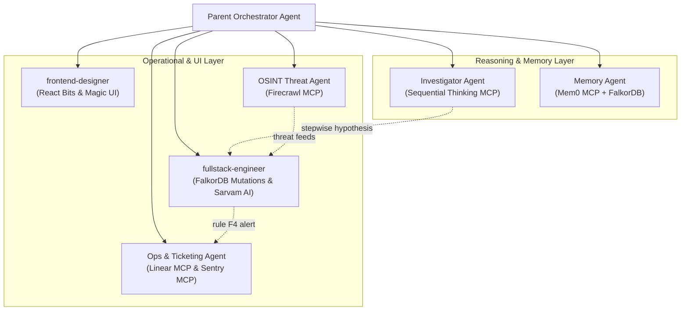

# SENGRA Model Context Protocol (MCP) Architecture & Integration Guide

> Exhaustive documentation of all Model Context Protocol (MCP) servers, tool catalogs, transport modes, and subagent orchestration in SENGRA.

---

## 1. What is MCP in SENGRA?

The **Model Context Protocol (MCP)** is an open standard that enables autonomous AI coding agents, forensic copilots, and multi-agent workflows to interact deterministically with external systems (graph databases, UI component registries, browser automation engines, persistent memory platforms, and devtools).

In SENGRA, MCP serves five critical functions:
1. **Deterministic Graph Querying**: FalkorDB MCP allows agents to inspect graph schema, execute parameterized OpenCypher, and query read-only replicas without raw terminal risk.
2. **Visual & UI Component Generation**: `shadcn` and `magicuidesign` MCPs allow agents to fetch React Bits and liquid glass components directly from official registries.
3. **Autonomous End-to-End Verification**: Playwright MCP provides structured accessibility tree inspection and UI validation without relying on flaky vision models.
4. **Structured Multi-Step Reasoning & Memory**: Sequential Thinking and Mem0 MCPs provide dynamic thought branching, hypothesis verification, and cloud-synchronized associative memory.
5. **Observability, Incident Ticketing & OSINT**: Sentry, Linear, and Firecrawl MCPs enable live runtime error diagnosis, automated AML compliance ticketing, and external OSINT threat intelligence scraping.

---

## 2. Comprehensive MCP Server Directory

```
┌──────────────────────────────────────────────────────────────────────────────────┐
│                             SENGRA MCP ECOSYSTEM                                 │
├───────────────────────┬──────────────────────────────────┬───────────────────────┤
│ Server Identifier     │ Package / Source                 │ Primary Responsibility│
├───────────────────────┼──────────────────────────────────┼───────────────────────┤
│ playwright            │ @playwright/mcp@latest           │ Browser E2E Testing   │
│ falkordb              │ @falkordb/mcpserver@latest       │ OpenCypher Execution  │
│ falkordb-readonly     │ @falkordb/mcpserver (read-only)  │ Replica Safe Queries  │
│ shadcn                │ shadcn@latest mcp (@react-bits)  │ Liquid Glass UI Trees │
│ magicuidesign-mcp     │ @magicuidesign/mcp@latest        │ Glows, Marquees, FX   │
│ next-devtools         │ next-devtools-mcp@latest         │ Turbopack Route Audit │
│ sengra-mcp            │ apps/web/src/app/api/mcp         │ 15 Fraud Tools (JSON) │
│ sequential-thinking   │ @modelcontextprotocol/server-seq │ Stepwise Hypothesis   │
│ mem0                  │ https://mcp.mem0.ai/mcp          │ Cloud Long-Term Memory│
│ sentry                │ https://mcp.sentry.dev/mcp       │ Production Telemetry  │
│ linear                │ https://mcp.linear.app/mcp       │ AML Incident Tickets  │
│ firecrawl             │ https://mcp.firecrawl.dev/v2/mcp │ OSINT Web Scrape & Intel│
└───────────────────────┴──────────────────────────────────┴───────────────────────┘
```

---

## 3. Deep Dive: Server Specifications & Tool Catalogs

### 3.1. `playwright` — Headless Browser Automation
- **Package**: `@playwright/mcp@latest`
- **Transport**: `stdio` / `SSE` (port 8931)
- **Key Advantage**: Operates on Playwright's **Accessibility Tree (ARIA snapshot)**, consuming 90% fewer tokens than screenshot-based vision models while maintaining 100% deterministic interaction.

#### Available Tools:
| Tool Name | Parameters | Purpose |
|---|---|---|
| `browser_navigate` | `url: string` | Navigate to local or production URL (`http://localhost:3000`) |
| `browser_snapshot` | `target?: string, boxes?: boolean` | Capture structured accessibility tree with coordinates |
| `browser_click` | `target: string, element?: string` | Click buttons, scenario tabs, or canvas nodes |
| `browser_type` | `target: string, text: string, submit?: boolean` | Fill input fields (e.g. Sarvam copilot prompt) |
| `browser_take_screenshot`| `filename?: string, fullPage?: boolean` | Capture pixel evidence for QA audit artifacts |
| `browser_wait_for` | `text?: string, time?: number` | Wait for async forensic analysis or stream completion |
| `browser_evaluate` | `function: string` | Execute client-side JavaScript in page context |
| `browser_network_requests` | `filter?: string` | Inspect live `/api/sarvam` and `/api/freeze` HTTP requests |

---

### 3.2. `falkordb` & `falkordb-readonly` — Graph Database Engine
- **Package**: `@falkordb/mcpserver@latest`
- **Protocol**: Redis Serialization Protocol (RESP3) via `GRAPH.QUERY` and `GRAPH.RO_QUERY`
- **Role**: Primary graph store for accounts, devices, IP addresses, transactions, and immutable compliance decisions.

#### Environment Variables:
```bash
FALKORDB_HOST=localhost          # FalkorDB host or cloud endpoint
FALKORDB_PORT=6379               # FalkorDB RESP port
FALKORDB_PASSWORD=               # Authentication token
FALKORDB_DEFAULT_READONLY=false  # Primary write-capable instance
```

#### Read-Only Replica Server (`falkordb-readonly`):
```bash
FALKORDB_DEFAULT_READONLY=true   # Routes exclusively through GRAPH.RO_QUERY
```
- **Safety**: Prevents destructive accidental mutations (`DELETE`, `DETACH DELETE`, `SET`) during speculative agent reasoning.
- **Reporting**: Perfect for read-heavy investigator dashboard queries and graph metric computations.

---

### 3.3. `sequential-thinking` — Multi-Step Hypothesis & Reasoning Engine
- **Package**: `@modelcontextprotocol/server-sequential-thinking`
- **Tool**: `sequential_thinking`
- **Role in SENGRA**: Empowers Sarvam AI 105B and the investigation orchestrator to decompose intricate fraud typologies into verified steps. Allows dynamic thought revisions, hypothesis branching between legitimate merchant hubs and mule aggregators, and counter-factual verification under the Skeptic challenge.

#### Input Fields:
- `thought` (string): Current forensic hypothesis or topological deduction.
- `nextThoughtNeeded` (boolean): Whether another verification step is required.
- `thoughtNumber` (integer): Sequential step index.
- `totalThoughts` (integer): Dynamic estimated thought ceiling.
- `isRevision` (boolean): Reconsidering an earlier deduction upon new graph evidence.
- `branchFromThought` / `branchId`: Branching alternative laundering scenarios.

---

### 3.4. `mem0` — Cloud-Native Associative Memory Platform
- **Endpoint**: `https://mcp.mem0.ai/mcp`
- **Transport**: Streamable HTTP / Bearer Auth (`MEM0_API_KEY`)
- **Role in SENGRA**: Complements FalkorDB's graph memory with semantic vector search across historical investigations, past false-positive dismissals, and compliance officer precedents.

#### Available Tools:
- `add_memory`: Persists unstructured forensic findings, officer notes, and syndicate summaries.
- `search_memories`: Semantic hybrid search over previous fraud cases and cleared family clusters.
- `get_memories`: Retrieves paginated investigation logs with metadata filters.
- `get_memory` / `update_memory`: Fine-grained retrieval and modification of case citations.
- `delete_memory` / `delete_all_memories`: Data retention management per GDPR/DPDP requirements.

---

### 3.5. `sentry` — Real-Time Production Error Observability
- **Endpoint**: `https://mcp.sentry.dev/mcp`
- **Transport**: Streamable HTTP with OAuth / Bearer Auth
- **Role in SENGRA**: Monitors Next.js Serverless runtime health (`/api/sarvam`, `/api/freeze`, `/api/mcp`), catches unhandled Redis protocol disconnects, and profiles in-memory Graphology execution performance.

---

### 3.6. `linear` — Autonomous Compliance Incident Ticketing
- **Endpoint**: `https://mcp.linear.app/mcp`
- **Transport**: Streamable HTTP via `mcp-remote`
- **Role in SENGRA**:
  - Automatically files high-priority compliance audit issues when Rule F4 flags an account with `HOLD_FOR_REVIEW`.
  - Links evidence paths directly into ticket descriptions.
  - Closes compliance tickets with audit IDs when an authorized officer executes a gated freeze.

---

### 3.7. `firecrawl` — OSINT Threat Intelligence & Infrastructure Scraping
- **Endpoint**: `https://mcp.firecrawl.dev/v2/mcp-oauth`
- **Role in SENGRA**: Gathers open-source intelligence on malicious IP addresses, newly registered phishing domains, and CVE vulnerability databases (e.g. CVSS 10.0 CVE-2024-3094 xz-utils) to enrich device node metadata in FalkorDB.

---

### 3.8. `shadcn` — React Bits & Component Registry MCP
- **Package**: `shadcn@latest mcp`
- **Registry Integration**: Configured in `components.json` with `@react-bits`:
  ```json
  {
    "registries": {
      "@react-bits": "https://reactbits.dev/r/{name}.json"
    }
  }
  ```
#### Available Tools:
- `get_project_registries`: Lists configured registries including `@react-bits`.
- `list_items_in_registries`: Explores available liquid glass, aurora, and glassmorphic components.
- `search_items_in_registries`: Searches for glass buttons, refraction cards, dither backgrounds.
- `view_items_in_registries`: Fetches the exact TypeScript/JSX implementation code.

---

### 3.9. `magicuidesign-mcp` — High-Appeal Visual Polish & Motion
- **Package**: `@magicuidesign/mcp@latest`
- **Purpose**: Provides production-grade motion primitives, neon border glows, blur-fade entrance transitions, and interactive radar displays.

---

### 3.10. `next-devtools` — Turbopack & Runtime Health Inspector
- **Package**: `next-devtools-mcp@latest`
- **Purpose**: Allows AI agents to audit active Next.js routes, verify Serverless function execution times (`maxDuration`), and diagnose compilation errors.

---

### 3.11. `sengra-mcp` — Certified Fraud & Security Tool Catalog
- **Endpoint**: `http://localhost:3000/api/mcp`
- **Protocol**: JSON-RPC 2.0 over HTTP POST
- **Catalog Size**: 15 Production Tools

#### The 15 Native Tools:
1. `query_graph`: Read-only OpenCypher query execution with parameterized bindings.
2. `find_mule_rings`: Louvain community detection and cycle identification.
3. `trace_evidence_path`: Dijkstra shortest-path between suspect accounts and known-bad devices.
4. `check_bad_devices`: Lookup device fingerprint against threat intelligence databases.
5. `evaluate_rule_f4`: Rule F4 compliance evaluation (multi-hop freeze thresholds).
6. `run_skeptic_challenge`: Devil's advocate falsification to prevent false-positive freezes.
7. `record_compliance_decision`: Write immutable audit decision to FalkorDB decisions graph.
8. `compute_betweenness`: Brandes betweenness centrality ranking to identify aggregator mules.
9. `detect_communities`: Graphology modularity maximization clustering.
10. `cve_to_fraud_links`: Cross-domain bridge between CVE vulnerabilities and compromised accounts.
11. `calculate_blast_radius`: Concentric hop traversal around compromised infrastructure.
12. `evaluate_finding_priority`: P0 Critical to P3 Low SLA risk classification.
13. `who_knows_system`: Ownership and code author attribution for compromised services.
14. `fetch_sar_context`: FinCEN Suspicious Activity Report narrative extraction.
15. `verify_freeze_state`: Real-time query of account freeze status and compliance officer signature.

---

## 4. Subagent Background Orchestration Architecture

SENGRA coordinates specialized subagents connected to specific MCP servers in the background:



---

## 5. Security & Isolation Standard

1. **Parameter Binding Requirement**: All Cypher executions through `falkordb` MCP or `/api/mcp` must use `$params` dictionaries. String concatenation is strictly prohibited by harness path guards.
2. **Read-Only Enforcement**: Agents conducting read-only investigation are routed to `falkordb-readonly` (`GRAPH.RO_QUERY`) to guarantee data integrity.
3. **Two-Stage HITL Mutation Gate**: No write mutation on suspect customer accounts occurs autonomously without Human-in-the-Loop compliance officer signature recorded in the `decisions` graph.
