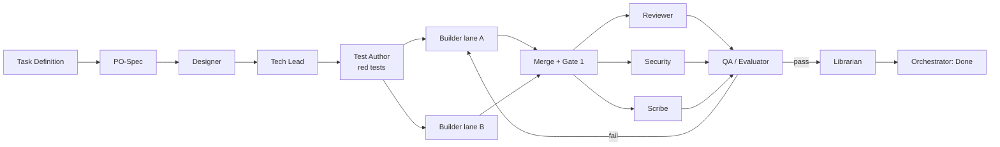

# Pipeline Workflow — Stage Graph & Handoffs

> Canonical execution pipeline for SENGRA features and tasks.

---

## 1. Stage Graph

---

## 2. Stage Execution Protocol

1. **PO-Spec**: Produces `01-spec.md` with user stories, acceptance mapping, and edge cases.
2. **Designer**: Produces `02-design.md` covering API contracts, data models, Cytoscape visual interactions, and Mermaid flows.
3. **Tech Lead**: Produces `03-plan.md` defining file-level change lists, lane decomposition, exclusive file ownership, and rollback strategies.
4. **Test Author**: Writes failing tests **first** (`tests/**`) and produces `04-tests.md` recording the red test execution.
5. **Builder(s)**: Implement minimal code changes within assigned lanes to turn tests green; produce `05-build-<lane>.md`.
6. **Merge + Gate 1**: Merges lane branches, runs linters, type checks, and unit tests.
7. **Reviewer, Security, Scribe**: Run concurrently.
   - Reviewer: Code standards, complexity, diff limits (`06-review.md`).
   - Security: Dependency review, secret scan, injection checks (`06b-security.md`).
   - Scribe: Documentation, README, ADRs (`08-docs.md`).
8. **QA / Evaluator**: Runs Gate 4 (integration tests, verification against spec); produces `07-qa.md`.
9. **Librarian**: Synthesizes learnings into `docs/memory/lessons.md` and updates `AGENTS.md`.
10. **Orchestrator**: Validates Definition of Done, ratifies completion, and marks state done.
